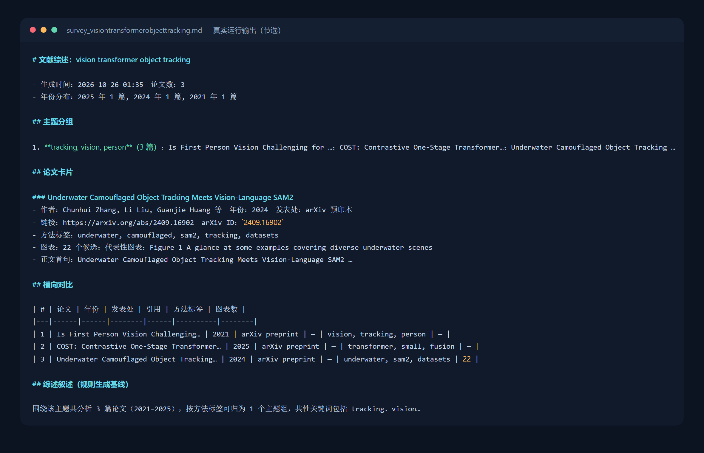

# lit-review-agent · 文献调研 Agent

[](https://github.com/XiaoMa-77/lit-review-agent/actions/workflows/ci.yml)
[](pyproject.toml)
[](LICENSE)

一条命令完成一次小型文献调研：**检索 → 下载 → 读图 → 对比 → 综述**。给定研究主题，Agent 从 arXiv（OpenAlex 增强）检索论文，流式下载 PDF 并缓存，提取每篇论文的图表清单（含 caption 绑定），做跨论文的方法标签/相似度/主题聚类分析，最终产出一份结构化中文综述（Markdown）与 `papers.json`。


## 设计原则

- **每一级都可降级**：OpenAlex 被限流 → 退避重试后降级为 arXiv 单源；某篇 PDF 下载失败 → 该论文保留为元数据卡片；未配置 LLM → 规则基线综述照常生成。流水线永不因单点失败而中断。
- **LLM 是可选增强**：不配任何 API Key，全部功能可用；配置 OpenAI 兼容端点后，仅"综述叙述"一节由 LLM 重写，事实表格永远来自确定性代码。
- **离线可复跑**：PDF 缓存在 `~/.litreview/cache`，`--offline` 模式纯本地复现整条流水线（测试即基于此设计）。

## 快速开始

```bash
pip install -e ".[pdf]"          # 基础 + PDF 提取
litreview "vision transformer object tracking" --limit 6 --out reports
```

输出：

```
reports/survey_<query>.md   # 中文综述：主题分组 / 论文卡片 / 横向对比 / 叙述 / 参考
reports/papers.json         # 归一化论文元数据
```



常用参数：`--no-pdf`（跳过下载）、`--no-openalex`（arXiv 单源）、`--no-llm`（纯规则综述）、`--offline`（只用缓存）、`-v`（调试日志）。

## 五个阶段

| 阶段 | 实现 | 说明 |
|---|---|---|
| ① 检索 | `sources.py` | arXiv Atom API 主源；OpenAlex 补引用数/venue；跨源指纹去重（arXiv id / DOI 归一化），OpenAlex 429 自动指数退避 |
| ② 下载 | `pdf.py` | 流式下载 + 25MB 上限 + 内容校验；`~/.litreview/cache` 按论文 ID 缓存 |
| ③ 读图 | `pdf.py` | pymupdf 提取内嵌图像；尺寸阈值过滤图标/水印；caption 启发式绑定（Figure/Fig./Table/图/表 + 位置距离）；figure/table 分类 |
| ④ 对比 | `compare.py` | tf-idf 判别性方法标签、摘要 Jaccard 相似度、高频词重叠系数贪心聚类、横向对比表 |
| ⑤ 综述 | `survey.py` | 规则基线（主题分组/论文卡片/对比表/叙述/参考）+ 可选 LLM 润色（失败自动回退基线） |

## MCP Server

`[mcp]` extra 提供标准 stdio MCP 服务，可在任何 MCP 客户端（Claude Desktop、ZCode 等）中把文献调研当作工具调用：

```json
{"mcpServers": {"litreview": {
  "command": "python",
  "args": ["-m", "litreview.mcp_server"]}}}
```

工具：`litreview_search(query, limit)` 返回结构化论文 JSON；`litreview_survey(query, limit, out_dir)` 返回完整综述 Markdown。

## 可选 LLM 润色

```json
// ~/.litreview/config.json
{"base_url": "https://api.example.com/v1",
 "api_key": "sk-...", "model": "glm-4-flash"}
```

配置后 `survey` 的叙述一节由 LLM 基于"工具提取的结构化事实"重写（提示词约束：不得编造事实、不得新增论文）；任何失败都会回退规则基线并在文末注明。

## 测试

```bash
pip install -e ".[pdf,mcp,dev]"
python -m pytest tests -q      # 23 项离线测试
```

测试不打网络：HTTP 层用 `httpx.MockTransport`（含 429 重试路径），PDF 层在测试内用 pymupdf **合成**带图表与 caption 的 PDF，聚合/综述层用构造语料验证。CI（Ubuntu / Python 3.10–3.13）同时做 CLI 冒烟、MCP 导入检查与 compileall。

## 许可证

[MIT](LICENSE) © 2026 XiaoMa-77
