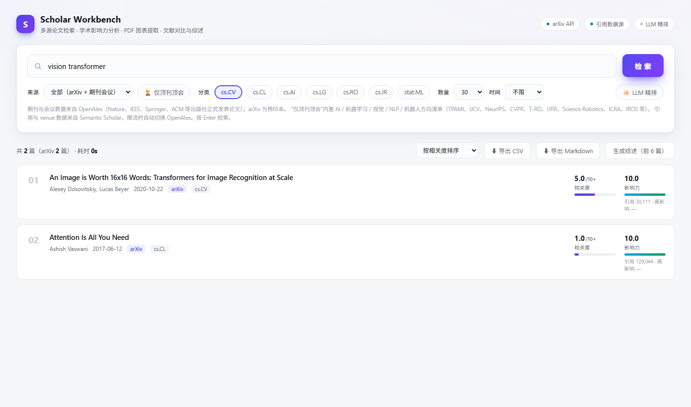
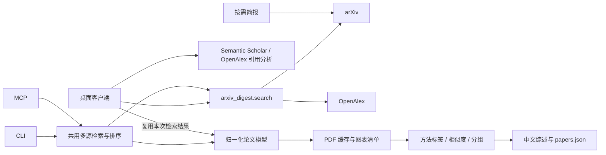

# Scholar Workbench · 一体化科研文献工作台

[](https://github.com/XiaoMa-77/scholar-workbench/actions/workflows/ci.yml)
[](pyproject.toml)
[](LICENSE)

**从发现论文到形成综述，在一个项目中完成。**

Scholar Workbench 将多来源论文检索、桌面交互、引用分析、按需论文简报、PDF 图表清单、跨论文比较和中文综述整合为一条工作流。既可以通过本地桌面窗口探索研究方向，也可以通过 CLI 或 MCP 将文献调研接入自己的工具链。

本仓库整合了原 `arxiv-digest-agent` 与 `lit-review-agent` 的功能、测试和 Git 提交历史。**每日日报自动更新已取消**；论文简报由命令行或 GitHub Actions 手动生成。

## 目录

- [功能概览](#功能概览)
- [安装与快速开始](#安装与快速开始)
- [桌面客户端](#桌面客户端)
- [命令行用法](#命令行用法)
- [按需论文简报](#按需论文简报)
- [LLM 配置](#llm-配置)
- [MCP 接入](#mcp-接入)
- [输出、缓存与离线复现](#输出缓存与离线复现)
- [架构与算法](#架构与算法)
- [测试与开发](#测试与开发)
- [迁移说明](#迁移说明)
- [常见问题](#常见问题)
- [数据来源与许可](#数据来源与许可)

## 功能概览

| 能力 | 具体功能 | 使用入口 |
| --- | --- | --- |
| 多来源检索 | arXiv 预印本、OpenAlex 期刊与会议论文；合并去重 | 桌面 / CLI / MCP |
| 论文筛选 | 关键词、arXiv 分类、发表时间、来源、顶刊顶会清单 | 桌面 / CLI |
| 相关度排序 | 标题与摘要的带权关键词打分 | 桌面 / CLI / MCP |
| 引用与影响力 | 桌面端优先查询 Semantic Scholar，失败时回退 OpenAlex | 桌面 |
| 可选 LLM 精排 | 相关性分、中文理由与摘要中译 | 桌面 / 简报 |
| PDF 处理 | 流式下载、大小限制、本地缓存、文本与内嵌图片提取 | 综述流水线 |
| 图表清单 | 图像尺寸过滤、图注位置匹配、figure/table 候选分类 | 综述流水线 |
| 跨论文对比 | 方法标签、摘要相似度、主题分组与横向对比表 | 综述流水线 |
| 中文综述 | 确定性事实表格、论文卡片、参考文献、可选 LLM 叙述 | 桌面 / CLI / MCP |
| 按需简报 | 按分类抓取近期论文、带权排序、历史去重、Markdown 输出 | CLI / 手动 Actions |
| 结果导出 | 桌面端 CSV、Markdown、BibTeX；综述元数据 JSON | 桌面 / CLI |


## 安装与快速开始

### 环境要求

- Python **3.11 或更新版本**。
- 在线检索需要能够访问 arXiv 与所选学术数据源。
- 桌面端使用 pywebview；Windows 需要可用的 WebView2 Runtime，其他系统需要相应的图形后端。
- PDF、桌面与 MCP 功能按需安装，基础检索和规则简报无需大模型 API Key。

### 克隆与安装

```bash
git clone https://github.com/XiaoMa-77/scholar-workbench.git
cd scholar-workbench
python -m venv .venv
```

激活虚拟环境：

```powershell
# Windows PowerShell
.\.venv\Scripts\Activate.ps1
```

```bash
# macOS / Linux
source .venv/bin/activate
```

选择需要的组件：

```bash
python -m pip install -e .                       # 基础检索、规则综述、按需简报
python -m pip install -e ".[pdf]"                 # 增加 PDF 下载与图表提取
python -m pip install -e ".[desktop,pdf]"         # 桌面检索与综述
python -m pip install -e ".[pdf,desktop,mcp]"     # 全部用户功能
python -m pip install -e ".[pdf,mcp,dev]"         # 开发、测试、检查与构建
```

仓库为私有时，克隆操作需要具备访问权限的 GitHub 账号。以上命令从本地源码安装。

### 完成第一次调研

```bash
scholar-workbench survey "vision transformer object tracking" --limit 6 --out reports/tracking --no-llm
```

输出 `survey_<query>.md` 与 `papers.json`。论文标题、作者、引用数、图表候选和对比表来自程序采集与计算；配置大模型后可进一步润色综述叙述。


## 桌面客户端

```bash
scholar-workbench desktop
# 等价入口
scholar-workbench-desktop
```



桌面操作流程：

1. 输入关键词或研究方向，选择来源、分类、数量与时间范围。
2. 按相关度、引用数、影响力或发表时间查看结果。
3. 点击论文查看完整摘要、命中词、发表信息与引用数据，复制 BibTeX。
4. 将检索结果导出为 CSV 或 Markdown。
5. 点击 **“生成综述（前 6 篇）”**，直接把本次检索排名前六篇送入 PDF / 对比 / 综述流水线；完整作者信息与 PDF 地址随结果传递，过程无需再次检索。

综述保存到 `~/.litreview/reports/`，同时提供 Markdown 下载。某篇 PDF 不可用时，该论文继续以元数据卡片参与综述。按钮使用最近一次检索得到的相关度排名；列表的显示排序只改变展示顺序。

顶部设置支持保存 LLM API Key、Base URL、模型名与测试连接。引用数据源状态可单独检测。桌面端与 CLI、MCP 共用检索实现与 LLM 配置。

## 命令行用法

### 统一入口

```bash
scholar-workbench --help
scholar-workbench search --help
scholar-workbench survey --help
scholar-workbench digest --help
```

| 命令 | 作用 |
| --- | --- |
| `scholar-workbench search "主题"` | 检索、去重、规则排序，向标准输出写入论文 JSON |
| `scholar-workbench survey "主题"` | 检索 → PDF → 图表清单 → 对比 → 综述 |
| `scholar-workbench "主题"` | 兼容原用法，等价于 survey |
| `scholar-workbench desktop` | 启动桌面客户端 |
| `scholar-workbench digest [参数]` | 手动生成一次论文简报 |
| `scholar-workbench-mcp` | 启动 stdio MCP 服务 |

### 检索示例

```bash
# 两来源合并检索
scholar-workbench search "vision transformer" --source all --limit 20

# 近 30 天的 arXiv 视觉论文；--category 可重复
scholar-workbench search "object tracking" --source arxiv --category cs.CV --days 30 --limit 20

# 正式期刊/会议中的顶刊顶会候选
scholar-workbench search "robot learning" --source openalex --venues-only --limit 10
```

关键词支持双引号短语，多词以 AND 语义检索。分类筛选作用于 arXiv；顶刊顶会过滤作用于 OpenAlex 部分。时间与期刊筛选可能使实际返回数少于 `--limit`。

### 综述示例

```bash
# 标准流程：下载 PDF 并提取图表
scholar-workbench survey "contrastive learning" --limit 6 --out reports/contrastive

# 快速生成元数据综述
scholar-workbench survey "robot learning" --limit 8 --no-pdf --no-llm --out reports/robot

# 仅检索 arXiv
scholar-workbench survey "object tracking" --source arxiv --category cs.CV --out reports/tracking

# 使用已有检索缓存和 PDF 缓存离线复现
scholar-workbench survey "contrastive learning" --limit 6 --out reports/replay --offline
```

### 检索与综述参数

| 参数 | 默认值 | 说明 |
| --- | --- | --- |
| `query` | 必填 | 研究主题或关键词 |
| `--limit` | `8` | 最多保留的论文数，范围 1–300 |
| `--source` | `all` | `all` / `arxiv` / `openalex` |
| `--category` | 空 | arXiv 分类，可重复传入 |
| `--days` | 不限 | 正整数，按发表日期限制时间窗口 |
| `--venues-only` | 关闭 | 对 OpenAlex 结果使用内置顶刊顶会清单 |
| `--out` | 当前目录 | 综述与元数据输出目录 |
| `--no-pdf` | 关闭 | 跳过 PDF 下载和提取 |
| `--no-llm` | 关闭 | 使用规则综述 |
| `--no-openalex` | 关闭 | 兼容参数，等价于 `--source arxiv` |
| `--offline` | 关闭 | 仅使用本地检索结果与 PDF 缓存 |
| `-v, --verbose` | 关闭 | 输出详细日志 |

`search` 使用来源、筛选、数量、离线与日志参数；PDF、LLM 和输出目录参数用于 `survey`。有论文时 CLI 返回 `0`，无结果或检索失败返回 `1`，用户中断返回 `130`。

## 按需论文简报

**仓库没有每日定时更新。** 以下命令只在调用时执行：

```bash
scholar-workbench digest
scholar-workbench digest --config config.yaml --top 20 --no-llm
scholar-workbench digest --date 2026-10-24 --no-llm

# 保留原命令与模块入口
arxiv-digest --config config.yaml
python -m arxiv_digest --no-llm
```

默认输出 `reports/YYYY-MM-DD.md`，日期窗口为指定日期及前一天。抓取后按发表日期过滤、规则打分、可选 LLM 精排，再扫描历史简报去重。窗口内没有新论文时跳过文件生成。

复制 [config.example.yaml](config.example.yaml) 为 `config.yaml`：

```yaml
categories: [cs.CV, cs.CL]
keywords:
  - {name: vision-language, weight: 3}
  - {name: diffusion, weight: 2}
  - {name: tracking, weight: 1}
top_n: 10
report_dir: reports
max_results: 300
lookback_days: 2
```

| 配置项 | 作用 |
| --- | --- |
| `categories` | 监控分类，多分类按 OR 联合查询 |
| `keywords` | 字符串或带权关键词列表，也支持“关键词 → 权重”映射 |
| `top_n` | 简报展示数量 |
| `report_dir` | Markdown 输出与历史去重目录 |
| `max_results` | 从 arXiv 取回的候选上限，再按日期过滤 |
| `lookback_days` | 包含指定日期当天的窗口天数 |

手动 Actions 位于 **Actions → 按需 arXiv 简报 → Run workflow**。可选 Secrets 为 `LLM_API_KEY`、`LLM_BASE_URL`、`LLM_MODEL`。该工作流仅声明 `workflow_dispatch`，生成后提交 Markdown；CI 工作流负责 push / PR 的测试。

历史简报与示例保存在 [reports/](reports/)，例如 [reports/example.md](reports/example.md)。

## LLM 配置

LLM 用于两类可选增强：

- **桌面 / 简报**：相关性精排、中文推荐理由、摘要中译。
- **综述**：依据已采集的结构化事实润色“综述叙述”部分，保留事实表格。

### 环境变量

```powershell
# PowerShell；请替换为你自己的兼容端点与模型
$env:LLM_API_KEY = "<your-api-key>"
$env:LLM_BASE_URL = "https://api.example.com/v1"
$env:LLM_MODEL = "<model-name>"
```

```bash
# macOS / Linux
export LLM_API_KEY="<your-api-key>"
export LLM_BASE_URL="https://api.example.com/v1"
export LLM_MODEL="<model-name>"
```

### 本地配置

桌面设置会写入 `~/.litreview/config.json`，也可手动创建：

```json
{
  "base_url": "https://api.example.com/v1",
  "api_key": "<your-api-key>",
  "model": "<model-name>"
}
```

读取顺序：有效的 `LLM_API_KEY` 环境变量 → `~/.litreview/config.json` → 原 `~/.arxiv-digest/llm.json`。环境变量设置 Key 时，未设置的 Base URL 与模型分别采用内置默认值 `https://api.openai.com/v1`、`gpt-4o-mini`；请按实际服务填写。

未配置 Key 时使用规则结果。LLM 失败时回退规则结果；`--no-llm` 和离线综述会跳过模型调用。API Key 保存在用户目录，避免将真实凭据加入 Git。

可选设置 `OPENALEX_EMAIL`，使 OpenAlex 请求携带联系邮箱。数据源的访问策略与额度以各服务当前规则为准。

## MCP 接入

安装 `mcp` 与所需 PDF 组件后，使用 stdio 连接：

```json
{
  "mcpServers": {
    "scholar-workbench": {
      "command": "/absolute/path/to/scholar-workbench/.venv/bin/python",
      "args": ["-m", "litreview.mcp_server"]
    }
  }
}
```

Windows 将 `command` 改为虚拟环境内的完整路径，例如 `C:\\projects\\scholar-workbench\\.venv\\Scripts\\python.exe`。

| 工具 | 参数 | 返回 |
| --- | --- | --- |
| `litreview_search` | `query`、`limit=8` | 归一化论文 JSON，使用共用检索与排序层 |
| `litreview_survey` | `query`、`limit=6`、`out_dir="."` | 完整中文综述 Markdown，附来源 / PDF 警告 |

`out_dir` 建议使用绝对路径，便于在 MCP 客户端定位报告。本项目固定使用 MCP Python SDK 1.x API（`mcp>=1.2,<2`），并测试工具注册与实际调用。

## 输出、缓存与离线复现

### 输出文件

```text
reports/tracking/
├── survey_<query>.md   # 主题分组、论文卡片、横向对比、叙述、参考
└── papers.json         # 完整归一化元数据
```

`<query>` 会归一为至多 40 字符的文件名片段。相同输出目录中的 `papers.json` 会被本次运行覆盖；为不同课题使用单独的 `--out` 目录。

元数据包含 `id`、`title`、`authors`、`year`、`venue`、`abstract`、`url`、`pdf_url`、`citations`、`source`、`primary_category`、`published`、`doi`。

### 缓存位置

| 路径 | 内容 |
| --- | --- |
| `~/.litreview/config.json` | 共用 LLM 配置 |
| `~/.litreview/cache/search-<sha256>.json` | 检索结果快照 |
| `~/.litreview/cache/<paper-id>.pdf` | 已下载 PDF |
| `~/.litreview/reports/` | 桌面端生成的综述 |
| `~/.arxiv-digest/llm.json` | 兼容读取的原 LLM 配置 |

离线缓存按**查询文本、limit、来源、分类、时间与顶刊筛选选项**区分。先在线运行相同参数的 search 或 survey，再加 `--offline`。离线模式不请求检索 API、不下载 PDF、不调用 LLM；缺少检索缓存时给出明确提示，缺少某篇 PDF 时继续生成元数据综述。

### Python API

```python
from litreview.agent import LitReviewAgent
from litreview.discovery import DiscoverySource

agent = LitReviewAgent(
    discovery=DiscoverySource(source="all", categories=["cs.CV"], days=90),
    use_llm=False,
)
papers = agent.search("object tracking", limit=6)
result = agent.run(
    "object tracking",
    papers=papers,         # 直接复用已选结果
    limit=6,
    out_dir="reports/tracking",
    pdf=True,
)
print(result.report_path)
```

## 架构与算法



- **相关度**：每个关键词的标题命中计 `3 × 权重`，摘要命中计 `1 × 权重`；同分优先较新的论文。桌面与简报可叠加 LLM 相关性分。
- **影响力**：使用可追溯的引用量及高影响力引用等数据形成辅助分数。论文引用分与期刊影响因子是不同指标。
- **多源合并**：通过 arXiv 标识、DOI 或标题匹配同一论文，并补充引用、venue 与可用 PDF 链接。
- **方法标签与比较**：采用词项统计、TF-IDF 风格区分词、摘要 Jaccard 相似度与启发式主题聚类。
- **图表清单**：PyMuPDF 提取 PDF 内嵌图像，过滤小图并按邻近文字匹配图注。扫描件、矢量图和复杂表格可能需要额外人工阅读；这里提供的是图表候选清单。
- **容错**：多来源搜索在一个来源失败时继续使用另一个来源；PDF 或 LLM 处理失败时保留可用的元数据与规则综述。

### 目录结构

```text
.
├── src/
│   ├── litreview/
│   │   ├── cli.py          # 统一命令入口
│   │   ├── discovery.py    # 共享检索及搜索模型 → 综述模型转换
│   │   ├── agent.py        # 缓存、PDF 与综述编排
│   │   ├── models.py       # 归一化论文 / 图表 / 内容模型
│   │   ├── pdf.py          # PDF 下载、提取和图表清单
│   │   ├── compare.py      # 标签、相似度、分组与对比表
│   │   ├── survey.py       # 规则综述与可选 LLM 润色
│   │   ├── llm.py          # 复用共用凭据的综述 LLM 客户端
│   │   ├── sources.py      # 原底层来源接口，保留注入与兼容能力
│   │   └── mcp_server.py   # stdio MCP 工具
│   └── arxiv_digest/
│       ├── search.py       # arXiv / OpenAlex 检索与去重
│       ├── fetcher.py      # Atom 解析、分类抓取与检索数据模型
│       ├── openalex.py     # 正式论文检索、开放 PDF 与引用兜底
│       ├── scorer.py       # 关键词打分
│       ├── impact.py       # Semantic Scholar 与 OpenAlex 引用分析
│       ├── venues.py       # 期刊会议清单
│       ├── llm.py          # 共用凭据、精排、摘要翻译
│       ├── desktop.py      # 桌面桥接、导出与综述衔接
│       ├── web/index.html  # 随安装包分发的桌面界面
│       ├── cli.py          # 兼容简报入口
│       └── reporter.py     # 简报渲染与历史去重
├── tests/
│   ├── digest/             # 原 digest 完整测试集
│   ├── test_integration.py # 共享检索、离线与桌面衔接
│   └── test_mcp.py         # MCP 注册与实际工具调用
├── docs/                   # 流程图、界面示例、历史与迁移记录
├── reports/                # 保留的历史简报与样例
├── config.example.yaml
└── .github/workflows/      # CI 与仅手动触发的简报
```

## 测试与开发

```bash
python -m pip install -e ".[pdf,mcp,dev]"
python -m pytest tests -q
python -m pytest tests -q --cov=scholar-workbench --cov=arxiv_digest --cov-report=term-missing
python -m ruff check src
python -m compileall -q src tests
python -m build
```

测试使用 Atom / OpenAlex 固定响应、HTTP mock 与合成 PDF，覆盖检索、打分、引用兜底、LLM 降级、PDF 与图注、主题比较、历史去重、共享检索、离线缓存、桌面到综述的元数据传递和 MCP 工具调用。测试会隔离本地真实 LLM 配置。

CI 使用 Python 3.11 / 3.12 / 3.13，执行离线测试、源码检查、CLI 冒烟、MCP 导入和分发包构建。桌面原生窗口依赖操作系统图形环境；桥接逻辑在无图形环境下测试。

合并版本的本地验证为 **115 项测试通过、语句覆盖率 89%**；详细环境与检查范围见 [docs/validation.md](docs/validation.md)。

## 迁移说明

- 统一仓库与安装分发名称为 `scholar-workbench`，最低 Python 版本提升为 3.11。
- 保留 `litreview`、`litreview-desktop`、`litreview-mcp`、`arxiv-digest`、`arxiv-digest-desktop` 和 `python -m arxiv_digest` 调用方式。
- 使用新的 `scholar-workbench search`、`survey`、`desktop`、`digest` 子命令统一访问功能。
- 原 LLM 配置自动兼容读取；桌面配置继续写入 `~/.litreview/config.json`，缓存与报告目录继续沿用。
- Python 模块名 `litreview` 与 MCP 工具名 `litreview_search` / `litreview_survey` 保持兼容。
- 两仓库的 Git 历史通过合并保留；原 digest 测试、历史简报、截图与变更记录一并迁移。
- 自动日报 cron 已移除。手动简报与 CI 继续可用。

迁移清单见 [docs/migration.md](docs/migration.md)，原 digest 变更记录见 [docs/history/arxiv-digest-changelog.md](docs/history/arxiv-digest-changelog.md)。

## 常见问题

**检索返回 0 篇或数量不足？**
减少关键词，放宽时间、分类或顶刊筛选；多词采用 AND 检索，部分结果会在本地再次筛选。

**某个数据源限流或不可达？**
使用 `--source arxiv` 或 `--source openalex` 切换来源；桌面引用查询会尝试备用来源。首次使用需建立缓存，之后可以离线复现。

**有论文信息但没有 PDF / 图表？**
部分期刊论文没有开放 PDF，下载也可能受网络与访问权限影响。元数据卡片与对比仍可生成；矢量图和扫描图表的提取效果取决于 PDF 结构。

**没有安装 PDF extra？**
先用 `--no-pdf` 生成元数据综述，或执行 `python -m pip install -e ".[pdf]"` 后使用完整流程。

**配置了 Key，仍然使用规则结果？**
检查环境变量是否覆盖了本地设置，确认 Base URL、模型名和网络连接。桌面设置提供“测试连接”。

**离线模式找不到搜索结果？**
使用与在线缓存一致的查询、limit 和筛选参数。历史 PDF 缓存与检索快照分开保存，仅有 PDF 时需要先补齐一次检索缓存。

## 数据来源与许可

代码与文档采用 [MIT License](LICENSE)，© 2026 XiaoMa-77。论文全文与第三方数据的使用遵循其各自的许可和服务条款：

| 来源 | 用途 |
| --- | --- |
| [arXiv API](https://info.arxiv.org/help/api/user-manual.html) | 预印本标题、作者、摘要、分类与 PDF 链接 |
| [OpenAlex](https://docs.openalex.org/) | 期刊会议元数据、引用量、发表信息与开放 PDF 链接 |
| [Semantic Scholar API](https://api.semanticscholar.org/) | 桌面端引用量、高影响力引用与发表信息 |
| 用户配置的 OpenAI 兼容服务 | 可选相关性评审、摘要中译与综述叙述 |

在线检索会向学术 API 发送查询；启用 LLM 后会向配置的模型服务发送相应论文信息或结构化事实。配置、缓存和生成的报告保存在本地；手动运行 GitHub 简报工作流时，生成的 Markdown 会提交到本仓库。
