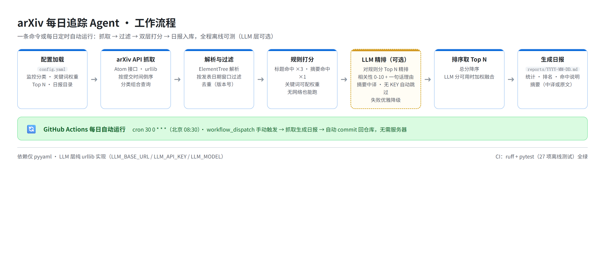

# arXiv 每日追踪 Agent

[](https://github.com/XiaoMa-77/arxiv-digest-agent/actions/workflows/ci.yml)

每天自动抓取指定 arXiv 分类的最新论文，按你的关键词打分排序，生成一份 Markdown 日报；可选接入任意 OpenAI 兼容大模型做相关性精排与摘要中译。纯本地 CLI + GitHub Actions 定时任务，无服务器、无数据库。



日报效果（由 [reports/example.md](reports/example.md) 渲染）：


## 功能特性

- **抓取**：直连 arXiv 官方 Atom API（urllib 实现，除 PyYAML 外零依赖），多分类联合查询（`cat:cs.CV OR cat:cs.CL`），按提交时间降序取回后按发表日期过滤，默认覆盖"昨天 + 今天"，窗口可配。
- **打分**：纯规则层完全离线可跑——标题命中记 3×权重、摘要命中记 1×权重，每个关键词可单独配置权重。
- **LLM 精排（可选）**：设置 `LLM_API_KEY` 后，对规则分 Top N 的论文调用 OpenAI 兼容 `chat/completions` 接口（支持 `LLM_BASE_URL` / `LLM_MODEL` 自定义端点与模型），得到 0-10 相关性分、一句话中文理由和摘要中译；无 Key 或调用失败时自动降级为规则分，绝不阻塞日报。
- **日报**：输出 `reports/YYYY-MM-DD.md`，开头是统计概览（总篇数、Top 分数），正文逐篇给出排名、分数、标题、作者（前三位 + et al.）、arXiv 链接、命中关键词或 LLM 理由、摘要（有 LLM 时为中文翻译）。
- **全自动**：GitHub Actions 每天北京时间 08:30 自动运行并把新日报提交回仓库，也支持手动触发。

## 快速开始

要求 Python 3.11+。

```bash
git clone https://github.com/XiaoMa-77/arxiv-digest-agent.git
cd arxiv-digest-agent
pip install -e .

# 直接运行（无配置时使用内置默认：cs.CV + cs.CL 与一组通用 CV 关键词）
arxiv-digest

# 使用自己的配置
cp config.example.yaml config.yaml   # 按需编辑分类与关键词
arxiv-digest --config config.yaml

# 常用参数
arxiv-digest --date 2026-10-24   # 指定日报日期（默认今天，窗口为昨天+今天）
arxiv-digest --top 20            # 日报展示前 20 篇
arxiv-digest --no-llm            # 跳过 LLM 精排，只用规则分
arxiv-digest --version
```

运行结束后日报位于 `reports/YYYY-MM-DD.md`。效果预览见 [reports/example.md](reports/example.md)。

## 桌面检索客户端

除了每日定时日报，本仓库还提供一个**交互式桌面检索工具**：输入关键词或整段研究方向描述，选择分类/数量/时间范围，检索 arXiv 并计算每篇论文的规则相关度与学术影响力。


```bash
pip install "arxiv-digest-agent[desktop]"   # 或本地：pip install -e '.[desktop]'
arxiv-digest-desktop
```

功能与数据口径：

| 能力 | 说明 |
|---|---|
| 关键词 / 研究方向检索 | 多个关键词取 AND（精确检索默认），按 arXiv 相关度排序取回 |
| 分类 / 数量 / 时间过滤 | 常见 cs.\* 分类多选，10~100 篇可选，近一周到一年或不限 |
| 相关度 | 关键词规则分（标题 ×3 / 摘要 ×1，与日报同源） |
| 学术影响力 | Semantic Scholar 真实数据：总引用数、高影响力引用数、正式发表 venue；"影响力分"为引用量对数综合分（0-10）——**arXiv 预印本没有期刊影响因子，本工具不编造，只用可溯源的引用数据** |
| LLM 精排（可选） | 配置 `LLM_API_KEY` 后可对 Top 20 做 0-10 相关性精排 + 摘要中译，未配置自动隐藏 |
| 详情与导出 | 点击行看完整摘要/命中词/引用详情，一键复制 BibTeX；结果可导出 CSV / Markdown |

界面为本地原生窗口（pywebview + WebView2），无服务器、无浏览器依赖、除两个学术 API 外不联网。检索、影响力与桥接逻辑均有离线单元测试覆盖（42 项）。

## 配置说明

| 配置项 | 默认值 | 说明 |
| --- | --- | --- |
| `categories` | `[cs.CV, cs.CL]` | 监控的 arXiv 分类，多个按 OR 联合查询 |
| `keywords` | 内置 CV 关键词 | 关键词列表，支持 `{name: xxx, weight: N}` 带权重或纯字符串（权重 1）；也支持 `{关键词: 权重}` 映射写法 |
| `top_n` | `10` | 日报展示的论文数量上限 |
| `report_dir` | `reports` | 日报输出目录 |
| `max_results` | `500` | 单次从 arXiv 取回的最大论文数（cs.CV + cs.CL 高峰日的兜底） |
| `lookback_days` | `2` | 日期窗口（含指定日期当天），2 表示"昨天 + 今天" |

LLM 精排通过环境变量开启，全部可选：

| 环境变量 | 默认值 | 说明 |
| --- | --- | --- |
| `LLM_API_KEY` | 无 | 设置后启用 LLM 精排与摘要中译，不设置则只用规则分 |
| `LLM_BASE_URL` | `https://api.openai.com/v1` | 任意 OpenAI 兼容端点均可 |
| `LLM_MODEL` | `gpt-4o-mini` | 使用的模型名 |

## 每日自动运行

仓库自带两个 workflow：

- **`daily.yml`**：cron `30 0 * * *`（北京时间 08:30）自动抓取当天论文、生成日报并提交回 `reports/`；也支持在 Actions 页面手动触发（`workflow_dispatch`）。想启用 LLM 精排，在仓库 Settings → Secrets and variables → Actions 中配置 `LLM_API_KEY`（可选 `LLM_BASE_URL`、`LLM_MODEL`），未配置时自动降级为纯规则打分。
- **去重与空窗**：日报窗口为"昨天 + 今天"，生成前会扫描已有日报跳过已报告过的论文；窗口内没有新论文（如周末）时不生成文件，仓库不会积累空日报。
- **注意**：GitHub 会在仓库连续 60 天没有 push 时自动停用定时任务，任意一次 push 即重置计时；被停用后也可在 Actions 页面一键重新启用。
- **`.github/workflows/ci.yml`**：每次 push / PR 运行 `ruff check` 与 `pytest`，保证代码质量。

Fork 本仓库即可获得属于自己的每日 arXiv 日报流。注意：Fork 出的仓库默认禁用 Actions，需到 fork 仓库的 Actions 页面点击 "I understand my workflows, go ahead and enable them" 手动启用；如需 LLM 精排，还要在 fork 仓库的 Secrets 里配置 `LLM_API_KEY`。

## 仓库结构

```
arxiv-digest-agent/
├── .github/workflows/     # CI 与每日定时任务
├── reports/               # 生成的日报（example.md 为效果示例）
├── src/arxiv_digest/
│   ├── __init__.py        # 版本信息
│   ├── __main__.py        # python -m 支持
│   ├── cli.py             # 命令行入口与配置加载
│   ├── fetcher.py         # arXiv Atom API 抓取与解析
│   ├── scorer.py          # 关键词规则打分
│   ├── llm.py             # 可选 LLM 精排（OpenAI 兼容协议）
│   └── reporter.py        # Markdown 日报渲染
├── tests/                 # 离线单元测试（内嵌 Atom fixture）
├── config.example.yaml    # 配置示例
├── pyproject.toml
└── README.md
```

## 许可

[MIT](LICENSE)
